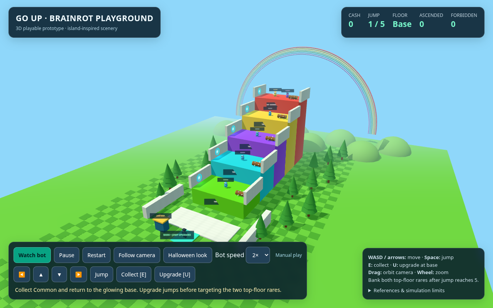
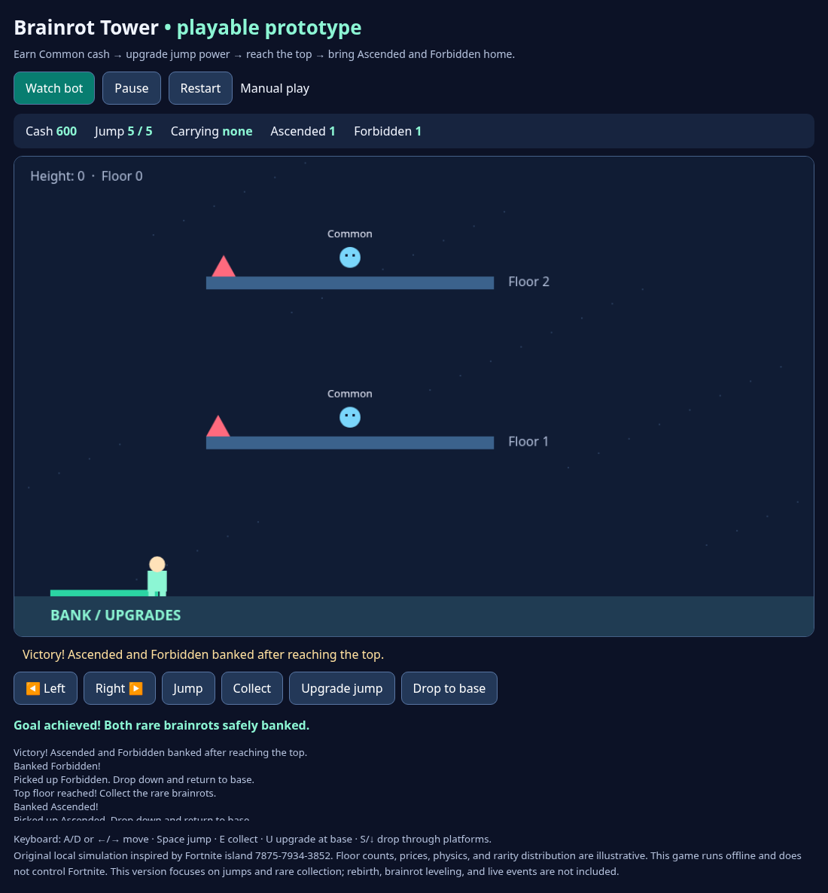

# Go Up for Brainrot — local simulation

Inspired by Fortnite island **7875-7934-3852** and its description supplied by
the user: jump higher, collect brainrots, upgrade jumps and brainrots, dodge
obstacles, and rebirth for extra cash.

The automated objective is to bank **Ascended and Forbidden** brainrots, collecting
those rarities **only on the last floor after reaching maximum jump power**.
Common brainrots are collected earlier solely to pay for jump upgrades. A pickup
counts toward the objective only after the bot returns it to base.

This is a simplified terminal simulation, not the Fortnite client or an exact
map replica. The description does not specify floor counts, upgrade prices,
rarity probabilities, movement physics, or rebirth rules. Current illustrative
rules use five floors, jump upgrade costs 20/40/60/80, a 10% obstacle chance,
and equally likely Ascended/Forbidden spawns on the top floor. There are no live
events, multiplayer, continuous physics, or passive cash income. Exact rules can
be adjusted in `tower.py` once known.

## Play the 3D game

Open [`gameplay3d.html`](gameplay3d.html) on GitHub, click **Download raw file**,
and open the downloaded file in Chrome, Edge, Firefox, or Safari. It is a single
self-contained file with an embedded Three.js renderer; no server, network,
account, or package installation is needed. Your browser needs WebGL enabled.
GitHub's code view does not execute HTML.

Click **Watch bot** for live 3D gameplay or **Take control** to play manually.
The bot funds jump upgrades with Common pickups, climbs the colored course,
collects Ascended and Forbidden only on the top floor with maximum jump power,
and brings them back to base. Bot speed is adjustable (1×/2×/4×).

- **WASD / arrows**: move relative to the camera.
- **Space**: jump. **E**: collect a nearby brainrot.
- **U**: buy a jump upgrade while standing at the glowing bank pad.
- **Mouse/touch drag**: orbit camera. **Mouse wheel**: zoom.
- Use **Overview**, **Pause**, **Restart**, and the on-screen movement controls.
- **Halloween look** toggles a decorative purple sky and pumpkins.

Walk back down to the glowing base to bank your carried brainrot. Spiked-log
contact sends you back to base and loses carried loot. Collection counts update
only when banked. Rares require arrival on the top floor and jump power 5.

The third-person character, environment, and creatures are original procedural
models. The color tiers, tiled walls, blue portals, trees, logs, and rainbow
are informed by the actual published island lobby image. The Halloween option
is informed by its promotional thumbnail. [Research notes and sources](RESEARCH.md)
distinguish images inspected from videos whose playback was blocked. Exact
map dimensions, prices, models, and physics remain illustrative.



### Develop and verify 3D

Sources: `src3d/shell.html` and `src3d/game.js`. Rebuild the offline file using:

```sh
python3 scripts/build_3d.py
```

The embedded engine is Three.js **0.160.1**, verified against the official npm
package's SHA-512 integrity field. Its MIT license is in
`vendor/THREE-LICENSE.txt`. No dependencies are downloaded during rebuild or play.

With Playwright for Python and Chromium installed, run:

```sh
python3 scripts/check_3d.py
```

The checks use real Chromium WebGL, actual movement/physics, automated completion,
manual collection/banking/upgrading, pause, top-floor rarity gating, obstacle
loss, camera controls, a theme switch, and mobile layout. Screenshots go into
ignored `artifacts/`. Headless testing uses Chromium's software WebGL renderer;
this does not measure performance on the player's own graphics hardware.

## Play the browser game

Open [`gameplay.html`](gameplay.html) on GitHub, choose **Download raw file**,
and open the downloaded file in Chrome, Edge, Firefox, or Safari. No terminal,
server, or package installation is required. GitHub's code view itself does not
execute the game. This is a live playable game, not a recorded animation.

Click **Watch bot** for live automated gameplay or use **Take control** to play.
Controls: A/D or arrows to move, Space to jump, E to collect, U to buy a jump
upgrade at base, and S/down arrow to drop through platforms. On-screen buttons
also support touch controls. Pause and Restart are available.

The browser game has continuous gravity, one-way platforms, moving obstacles,
a scrolling camera, carrying and banking, and cash-funded jump upgrades. It
requires maximum jump power and arrival on the top floor for rare pickups.
The bot buys upgrades using Common collections, then banks one Ascended and one
Forbidden. Rebirth, brainrot leveling, and live events are not included in this
browser version. The Python economy prototype below has additional manual
progression options. Neither version measures actual Fortnite physics.



### Optional developer browser checks

With Playwright for Python and Chromium available, run
`python3 scripts/check_gameplay.py`. It validates the real game's physics and
manual controls, automatic completion, rare gating, and obstacle loss in headless
Chromium. These tools are only needed for developer testing, not to play.

### Earlier recordings

[`viewer.html`](viewer.html) is an older recorded replay rather than interactive
physics gameplay. [Video](media/brainrot-demo.mp4) also shows that older replay.
Use `gameplay.html` for the playable game.

## Run

Python 3.10+ is sufficient; no packages, GPU, accounts, or services are required.
From `/workspace/NAsserSaif`:

```sh
python3 tower.py auto
python3 tower.py auto --watch
python3 tower.py play
python3 tower.py evaluate --episodes 200
python3 -m unittest -v
```

Automation uses an explicit goal-directed policy: earn Common cash, buy jump
upgrades, reach the top, collect rare brainrots, and return them to base until
both target rarities are banked. It does not rebirth or spend on brainrot levels,
as those delay the requested objective. Leveling and rebirth are available in
manual play; use `level Ascended`, for example. Manual commands are `jump`,
`collect`, `return`, `upgrade`, `level Common/Ascended/Forbidden`, `rebirth`, `quit`.

`--seed` controls randomness. `--max-turns` caps an automated run; failure returns
a nonzero exit code. `--delay 0` removes pauses from `--watch`.
Each automatic run starts fresh and overwrites the default ignored
`artifacts/tower-run.json`, containing final state and action history. Use
`--output artifacts/another-run.json` to preserve separate runs. It does not
resume past progress. Evaluation checks independent seeds on these simulation
rules, not performance inside Fortnite.

## Earlier platform-learning experiment

`game.py` is a separate fixed platform map with a Q-learning bot. It is retained
as a learning experiment and does not include the tower economy or the requested
rarity objective. Use `python3 game.py train`, `evaluate`, `watch`, or `play`.
Its generated model is ignored at `artifacts/brainrot-bot.json`.

No commands here connect to or automate Fortnite.
